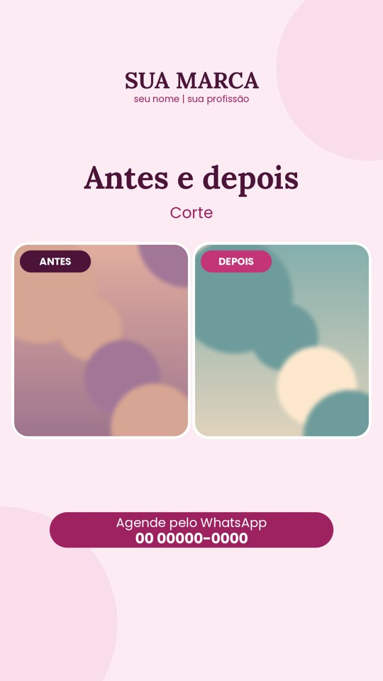
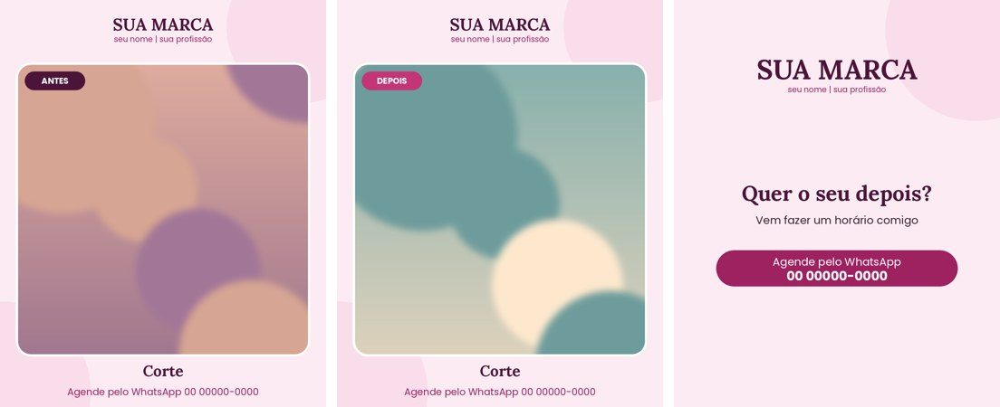
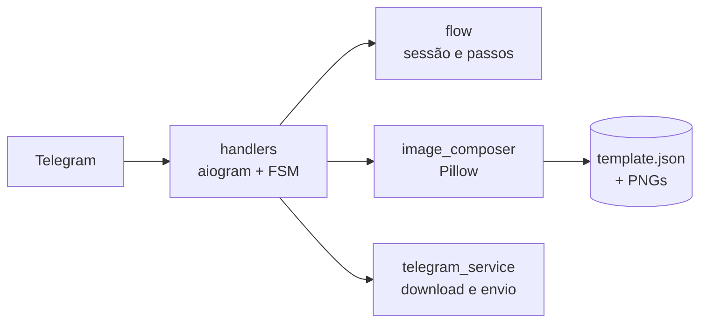

# Toque da Fé – Criador de Artes (bot do Telegram)

Bot do Telegram que **monta artes para redes sociais** de um salão de beleza: a pessoa escolhe um modelo,
envia as fotos, informa os textos e recebe a arte pronta, com a identidade visual da marca.
Projeto real, feito para uso interno, com montagem **100% determinística** (Pillow), sem IA generativa.

| Story com selo de preço | Story antes e depois | Carrossel (3 imagens em álbum) |
|---|---|---|
|  |  |  |

> Imagens geradas pelos **modelos de exemplo** do repositório (marca fictícia, foto sintética). Os modelos reais
> do salão (logo, contatos) não são públicos e ficam fora do repositório.

## O que ele faz
- **Conversa guiada por botões** (aiogram): escolher modelo → fotos → textos → arte pronta; voltar, recomeçar, cancelar e pular campos opcionais.
- **Modelos configuráveis por JSON**: novo design entra sem mexer no código. Campos fixos ficam na imagem; fotos e textos são slots com posição, fonte, cor e limites.
- **Motor de composição** (Pillow): recorte `cover`/`contain` sem distorcer, correção EXIF, cantos arredondados, moldura e selos *por cima* da foto, texto que reduz a fonte até caber, acentuação em português.
- **Carrossel**: uma única opção do menu que pede várias fotos e devolve várias imagens em álbum.
- **Alta qualidade sob demanda**: prévia em JPEG e opção de receber o PNG como arquivo.
- **Privacidade por padrão**: fotos só em memória, com expiração; acesso restrito a IDs autorizados; nenhum dado sensível nos logs.

## Arquitetura

Camadas de cada arte: **fundo → fotos → overlay → textos**. A conversa (`app/handlers`) não conhece os modelos:
ela só percorre os passos que o JSON declara (`app/services/flow.py`).

## Rodar sem Telegram (nenhuma conta necessária)
```bash
python3 -m venv .venv && source .venv/bin/activate
pip install -r requirements-dev.txt
python -m pytest -q                     # mais de 80 testes
python -m app.cli --listar              # usa os modelos de exemplo
python -m app.cli -t exemplo_servico_preco -f foto=minha.jpg -x titulo="Escova blindada" -x preco="R$ 70"
```

## Rodar o bot
```bash
cp .env.example .env    # TELEGRAM_BOT_TOKEN (do @BotFather) e ALLOWED_USER_IDS (use /meuid no bot)
python -m app.main
```
Sem a pasta `templates/`, o bot usa automaticamente os modelos de `examples/templates/` e avisa no log.

## Decisões de projeto
- **Determinismo em vez de IA generativa**: a arte tem de reproduzir o design da marca, sempre igual para as mesmas entradas.
- **Sem banco de dados**: sessões em memória com TTL; nada de foto de cliente em disco. Reiniciar apaga tudo.
- **Validação cedo**: todos os modelos são validados ao iniciar (schema, limites, referências do carrossel); erro aponta arquivo e campo.
- **Testes sem Telegram**: o fluxo completo roda pelo `Dispatcher` do aiogram com uma sessão HTTP simulada.
- **Segurança**: lista de IDs autorizados, limites de tamanho/resolução, nomes de arquivo do usuário nunca usados, uma geração por vez por pessoa.

## Estrutura
```
app/handlers/   start, escolha do modelo, coleta de fotos/textos, geração e botões do resultado
app/services/   flow, image_composer, template_service, telegram_service
app/models/     schema dos modelos (template_schema.py)
examples/       modelos sintéticos versionados (tools/make_example_templates.py)
templates/      modelos reais da marca (privado, fora do git)
tools/          conversores de exportações do Canva (PPTX/PNG) para modelos
deploy/         instalação como serviço no Google Cloud (e2-micro, nível gratuito)
tests/          testes automatizados (tests/private: fidelidade dos modelos reais, pulados sem eles)
```

## Adicionar um modelo
1. Exporte o design do Canva (PPTX é o ideal) e separe o que é fixo do que é variável.
2. Crie `templates/<id>/` com `background.png`, `overlay.png` (opcional) e `template.json` (copie um de `examples/templates`).
3. `python -m app.cli -t <id> ...` para conferir; o bot lista o modelo sozinho. Modelos auxiliares usam `"hidden": true`; carrossel usa `"type": "carousel"`.

## Hospedagem
Polling basta. O script `deploy/install_gcp.sh` instala o bot como serviço `systemd` numa VM e2-micro do Google Cloud.

## Licença
MIT (código). Fontes Lora e Poppins sob SIL OFL. Use fotos de clientes somente com autorização.
